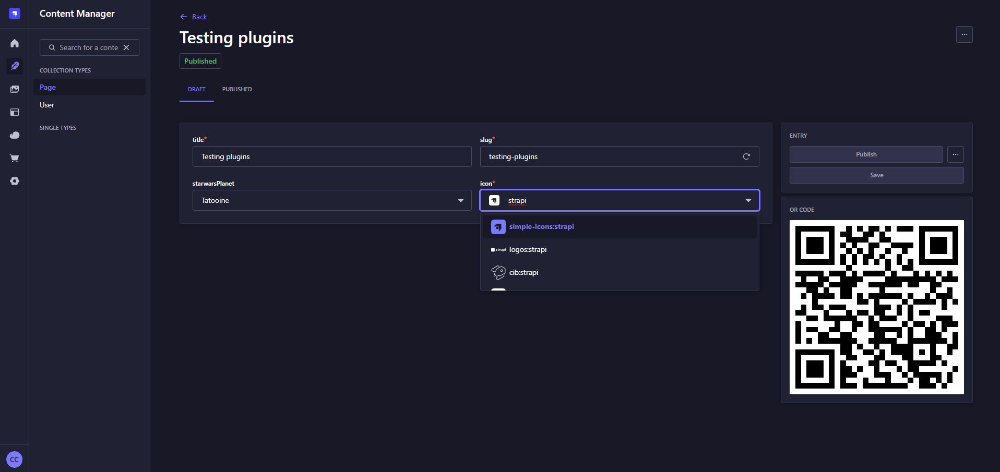

<div align="center" width="150px">
  
</div>
<div align="center">
  <h1>Strapi v5 - Plugin Generic Custom Fields</h1>
  <p>Powerful Strapi Plugin to easily create Custom Fields</p>
  <a href="https://www.npmjs.org/package/strapi-plugin-generic-custom-fields">
    
  </a>
  <a href="https://www.npmjs.org/package/strapi-plugin-generic-custom-fields">
    
  </a>
</div>

---

<div style="margin: 20px 0" align="center">
  
</div>

A plugin for [Strapi Headless CMS](https://github.com/strapi/strapi) that provides a powerful and easy way to add custom fields to your Strapi entities.

## Features
- Add custom fields to entities with a simple configuration.

### What can it be used for?
- Create an Enum field with labels
- Fetch items from an API (with or without authentication)
- Fetch items from a local source (json file, database, etc.)

## Roadmap
- Support pagination for fetching items
- Support for different field types (text, number, date, etc.)
- Validation rules for custom fields
- Any idea? [Open an issue](https://github.com/ChristopheCVB/strapi-plugin-generic-custom-fields/issues)

## Usage

To configure the Generic Custom Fields plugin, add your custom fields configuration to the plugin settings. Each custom field should follow this structure:

```typescript
type Config = {
  customFields: Array<{
    name: string;         // The unique name of the custom field.
    description?: string; // A description for the custom field.
    icon?: string;        // One of the supported StrapiIcon names, e.g. 'Alien', 'Archive', 'ArrowDown', etc.
    inputSize?: {
      default: 4 | 6 | 8 | 12; // Default input size.
      isResizable: boolean;    // Whether the input size can be changed.
    };
    searchable?: boolean; // Whether the custom field is searchable (calls fetchItems with query).
    fetchItems: ({ query: string | undefined }): { items: Item[] } | Promise<{ items: Item[] }>; // Function to fetch multiple items. This function is called on server-side.
    fetchItem: ({ value: string }): Item | Promise<Item>; // Function to fetch a single item. This function is called on server-side.
  }>,
}
type Item = {
    value: string; // Unique identifier for the item. This is used to store the value of the custom field.
    label: string; // Label of the item.
    icon?: {
      src: string; // URL of the icon.
      colorMask?: boolean; // Whether the icon should be masked with the color of the field.
    }
};
```
This configuration allows you to define custom fields that can fetch items either synchronously or asynchronously. The `fetchItems` function is used to retrieve a list of items based on a query string that can be empty, while the `fetchItem` function retrieves a single item based on its value.

### Advanced Settings

When adding or editing a custom field in Strapi's Content-Type Builder, open **Advanced settings**. These settings are configured separately for each attribute and use Strapi's built-in behavior.

| Setting | Description |
| --- | --- |
| **Default value** | Sets the default stored item value for new entries, including API creation when the field is omitted. |
| **Required field** | Requires a value for the field when creating an entry. |
| **Unique field** | Prevents entries from having the same stored item value, regardless of its label. |
| **Private field** | Excludes the field from content API responses. |

For **Default value**, use the item's stored `value`, not its `label`: for `{ value: 'FR', label: 'France' }`, enter `FR`. The default is saved as the attribute's top-level `default` in the content-type schema. The plugin does not backfill existing entries or validate the default against `fetchItem` when saving settings, so ensure the value can be resolved by your item source.

### Example Configuration

Check Wiki page for [Example Implementations](https://github.com/ChristopheCVB/strapi-plugin-generic-custom-fields/wiki/Example-implementations)

## Development

Install [mise](https://mise.jdx.dev/) and activate it in your shell, then run:

```sh
mise trust
mise install
pnpm install --frozen-lockfile
```

Mise installs Node 22 and enables Corepack, which selects the pnpm version declared in `package.json`.

```sh
pnpm typecheck:admin
pnpm typecheck:server
pnpm lint
pnpm exec playwright install chromium
pnpm test --run
pnpm test --run --project server
pnpm test --run --project admin
pnpm test:coverage
pnpm build
pnpm verify
```

Tests live in `tests/server/` (Node) and `tests/admin/` (real Chromium through Playwright). `pnpm test --run` runs both projects; use `--project server` or `--project admin` to select one. Both typechecks include their corresponding tests. Admin component tests render the real Strapi design-system controls and mock Strapi's fetch/query hooks.

Chromium runs headless by default. Use `pnpm test --project admin --browser.headless=false` to debug in a visible browser. On Linux, install browser system dependencies with `pnpm exec playwright install --with-deps chromium` if needed. Run the browser installation command again after updating Playwright.

`pnpm test:coverage` generates combined server and admin coverage in `coverage/`, with text, JSON, and HTML reports. Tests and test helpers are excluded; no minimum coverage threshold is enforced.

Pull requests and releases share CI: setup, parallel typecheck/lint/server-test/admin-test jobs, then build and verify. Only the admin job installs Chromium and its system dependencies. It caches Playwright browsers by runner OS, architecture, and the installed Playwright version; system dependencies are installed on each fresh runner, including cache hits. Coverage remains a local command. The release job installs dependencies, builds, verifies, and publishes as before. Manual releases must target a tag.
